<p align="center">
  
</p>

<h1 align="center">Linki</h1>
<p align="center">LinkedIn and email outreach in one sequence, with one inbox for the replies. Self-hosted.</p>

<p align="center">
  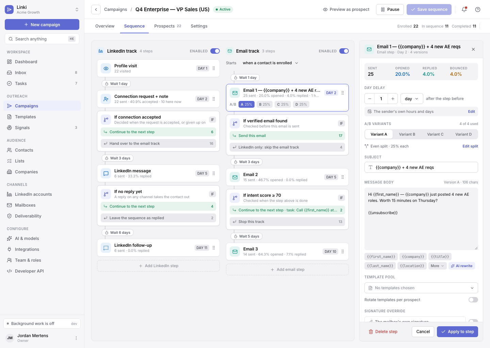
</p>

## What is Linki

Linki is sales outreach software you run on your own server. A campaign sends LinkedIn steps and emails side by side, moves a contact from one channel to the other when a condition says so, and stops when they reply. Replies from both channels arrive in one inbox. Around that sit the things outreach needs to keep working: limits and warm-up for every LinkedIn account and mailbox, a do-not-contact list, DNS checks, AI writing on your own key, reporting, team roles, a public API and an MCP server.

It is one container and one SQLite file. Your contacts, mailbox passwords and LinkedIn sessions stay on your machine.

Every picture on this page is of the demo workspace that `npm run seed:demo` creates. Nobody in it is real.

## What it does

### Campaigns and sequences

A campaign has a LinkedIn track and an email track, each with its own steps and its own switch.

- **Steps:** profile visit, connection request, LinkedIn message and email, with waits in hours or days and an optional sending window on any step.
- **Conditions between steps:** connection accepted, no reply yet, verified email found, or a rule about the contact (intent score, a signal, replied, connected, a custom field). Each outcome is yours to choose: continue, jump ahead, end the track, leave the sequence, or hand over to the email track. An outcome can also add the contact to a list or create a task. Every branch shows how many contacts took it.
- **Hand-over:** the email track can start when a contact is enrolled, or only once the LinkedIn track hands them over.
- **Email versions:** up to four versions of an email, split by the weights you set.
- **Merge tags and wording:** `{{first_name|there}}` falls back when a contact has no value, `{Hi|Hello}` varies the wording per contact, and a preview shows the message as one of your contacts would get it.
- **Unsubscribe where you put it:** write `{{unsubscribe}}` in an email and that email gets an unsubscribe link and the `List-Unsubscribe` header. An email without the tag gets neither.
- **Threaded follow-ups** and **sending in the recipient's own working hours** when their time zone is known.
- **Draft and publish:** edits to a running sequence are a draft until you save them, and contacts already part-way through keep their place.
- A wizard builds a new campaign in six steps and checks accounts, mailboxes and AI settings before launch.

<table>
  <tr>
    <td width="50%">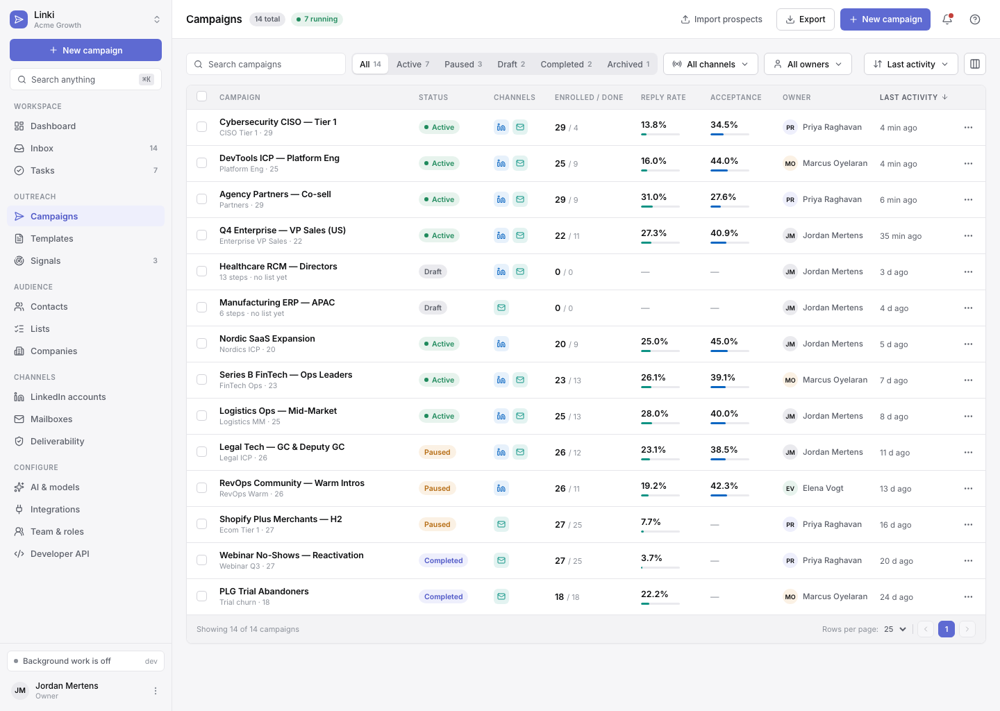</td>
    <td width="50%">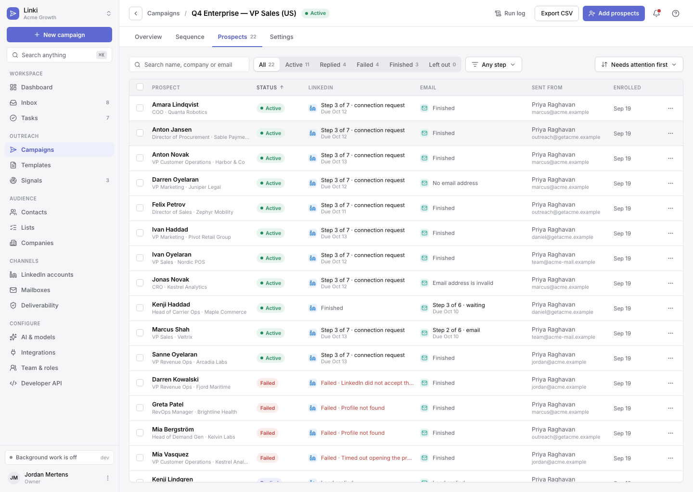</td>
  </tr>
  <tr>
    <td align="center">Campaigns</td>
    <td align="center">A campaign's prospects</td>
  </tr>
</table>

### LinkedIn accounts

- **Several accounts per campaign.** A campaign sends from a pool of accounts, in turn or by how much room each has left. A contact already reached from one account stays with it.
- **Limits per account:** invitations, messages, profile visits and withdrawals per day, and an optional weekly invitation limit counted over a rolling seven days. When a limit is reached the work waits for the next day; the campaign does not stop.
- **Warm-up:** a new account's daily invitations can rise in a straight line over a number of days you choose.
- **Working hours, days and time zone** per account, a pause switch, and a proxy you supply.
- **Two ways to sign in:** on the server, where Linki handles LinkedIn's email or SMS code and mobile-app approval, or by pasting a session cookie.
- **Holds instead of failures.** When LinkedIn ends a session or refuses an invitation, that account's LinkedIn steps wait and nobody is marked as failed. Other accounts and the email steps carry on.
- **Checked actions.** A connection request is recorded once LinkedIn shows it as pending, and a message once it appears in the conversation. Accepted invitations are read from the account's own connections list. An invitation left unanswered for the whole wait is withdrawn before the contact is skipped.

<p align="center">
  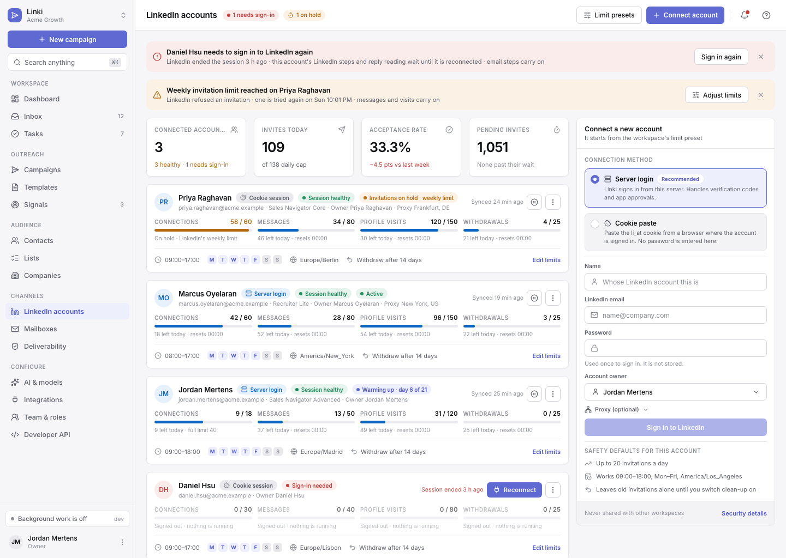
</p>

### Mailboxes and deliverability

- **Connect** Gmail or Google Workspace with an app password, or any mailbox over SMTP and IMAP.
- **Ramp and warm-up.** A new mailbox starts on a low daily limit that rises each day. Warm-up exchanges a few emails a day between a workspace's mailboxes and, unless the workspace opts out, with other workspaces' mailboxes on the same instance.
- **A guard** pauses a mailbox when its bounce rate or complaint rate over 30 days crosses a threshold you can change (3% and 0.1% to begin with, once 50 emails have gone out). Complaints are counted from the feedback reports a mailbox receives, which not every provider sends.
- **DNS:** SPF, DKIM, DMARC and MX are checked every day for each sending domain and summed up in a score. A changed record is written to the log and raises a notification.
- **Inbox placement tests** against addresses you choose, read back automatically when the address is one of your own connected mailboxes.
- **Do-not-contact list** for email addresses, domains, LinkedIn profiles and phone numbers, checked before every campaign step and every answer from the inbox, on both channels.
- A reputation reading per mailbox, a signature that can go on the first email of a sequence only, and a test send that says where it landed.

<table>
  <tr>
    <td width="50%">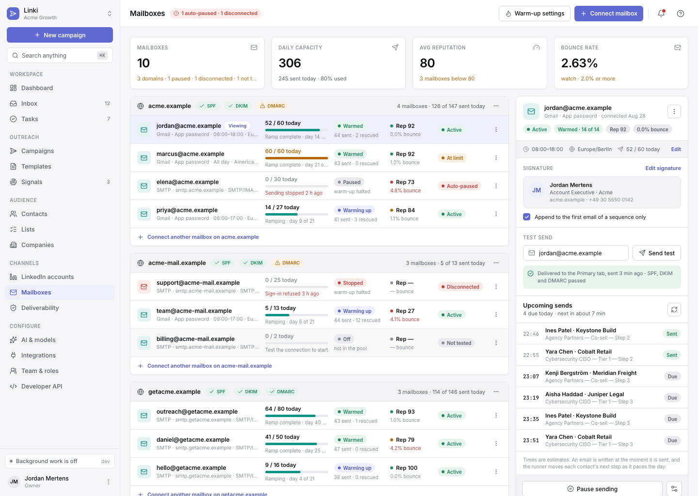</td>
    <td width="50%">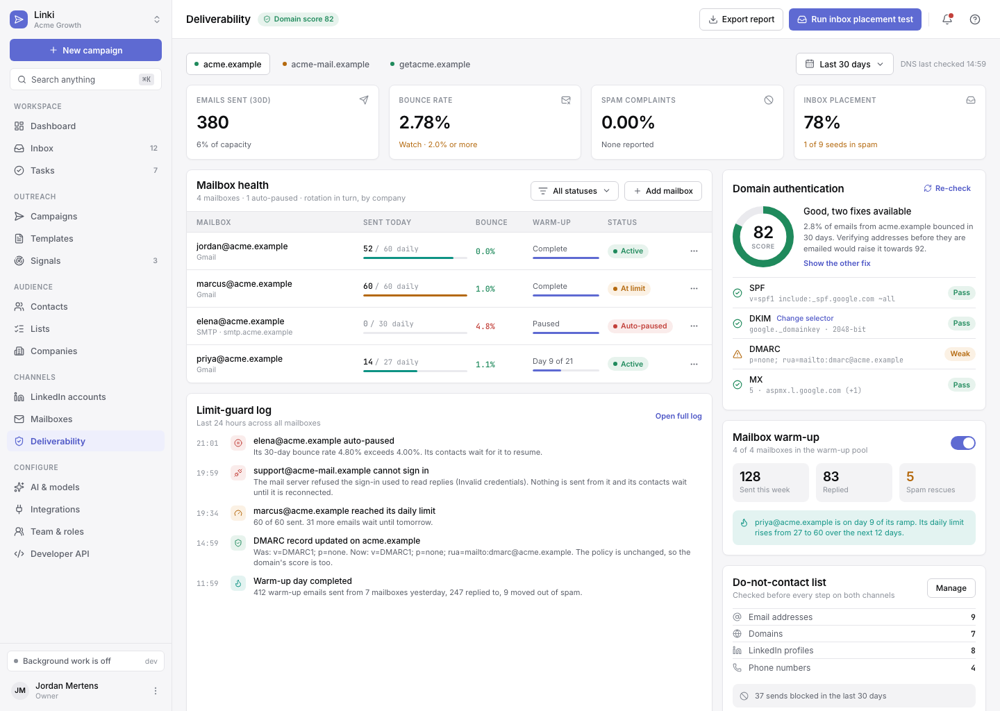</td>
  </tr>
  <tr>
    <td align="center">Mailboxes</td>
    <td align="center">Deliverability</td>
  </tr>
</table>

### Inbox

- **One inbox for both channels,** one thread per contact, holding what you sent and what they answered.
- **Replies are read for you.** With an AI model connected, each reply is classified as positive, needs review, out of office, negative or unsubscribe, with a confidence figure, a short summary and a suggested next step. A reply stops the contact's campaigns; an out-of-office puts the next step back. Without a model, simple rules decide and anything unclear is left for a person.
- **Answer from the thread,** by email or on LinkedIn. A LinkedIn answer is sent from the signed-in account; if LinkedIn does not confirm it, it is not retried by itself and the thread says so.
- **Work it as a team:** assign, snooze, close, tag, saved replies, a time by which each conversation is due an answer, and a lock that shows when a teammate is already replying.
- Each signed-in LinkedIn account's inbox is read every 15 minutes. It only reads, never marks a conversation as read, and keeps only conversations with people who are contacts in the workspace.

<p align="center">
  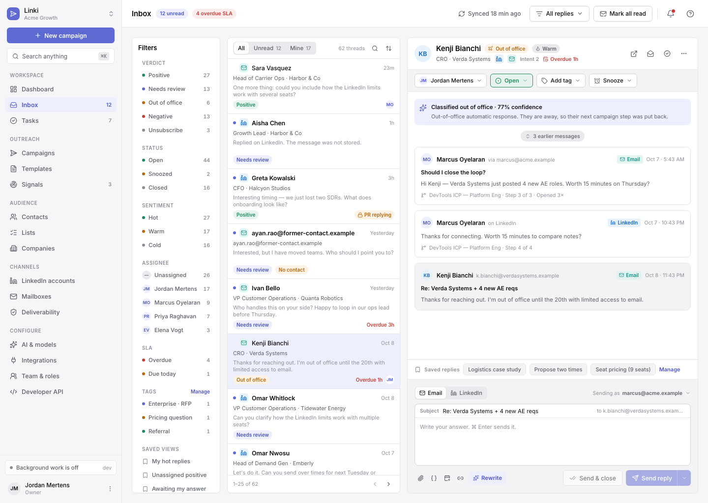
</p>

### AI writing

- **Your own key.** AI requests go through OpenRouter with a key the workspace supplies. You choose a default model and a fallback that is tried when the first does not answer.
- **A writing style** for the workspace: a tone, a written instruction, and example emails and LinkedIn messages.
- **Per step:** whether the step is written by AI, and its model, instruction, longest length and language.
- **A monthly budget.** When it is reached, steps written by AI wait and are tried again each hour, everything else keeps sending, and a notification is raised.
- **Spend** by kind of step and by model, and a test that writes for one of your contacts before anything is sent.

<table>
  <tr>
    <td width="50%">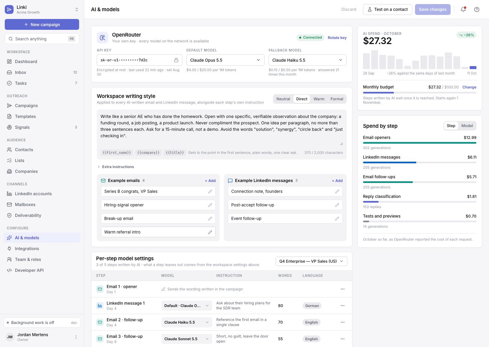</td>
    <td width="50%">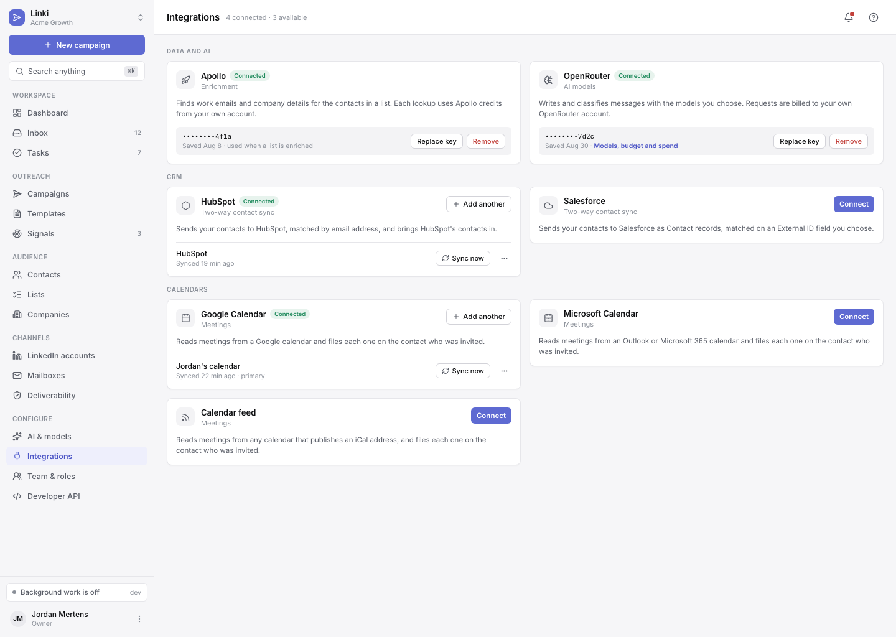</td>
  </tr>
  <tr>
    <td align="center">AI &amp; models</td>
    <td align="center">Integrations</td>
  </tr>
</table>

### Contacts, lists and companies

- **Import** from a Sales Navigator list (a LinkedIn Sales Navigator subscription is required) or a CSV file. Large Sales Navigator imports are spread over days under a daily cap.
- **Enrich** a list or a selection with Apollo, using your own Apollo key, and **verify** email addresses before sending.
- **A contact's page** has one timeline across both channels, their campaign history step by step, notes, tasks, custom fields and tags.
- **Lists** show how much of each is enriched and verified, and which campaign it feeds.
- **Import from CSV** is a page of four steps: upload, match the columns, decide what happens to people you already have, and check before anything is added. An import you leave can be picked up again, and a mapping is remembered for the next file like it.
- **Companies** are kept once and linked from their contacts. A company's page shows what is known about it (funding, headcount by department, the tools it uses), your contacts there, and the signals about it. Looking a company up on Apollo, or asking who else works there, shows what it will cost first. A company can be marked a target account, and a warning appears when email to its domain starts bouncing.
- Custom fields (text, number, yes/no, date), contact tags, saved views, filters, and bulk actions.

<table>
  <tr>
    <td width="50%">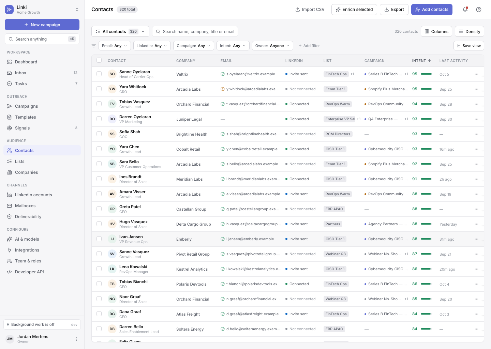</td>
    <td width="50%">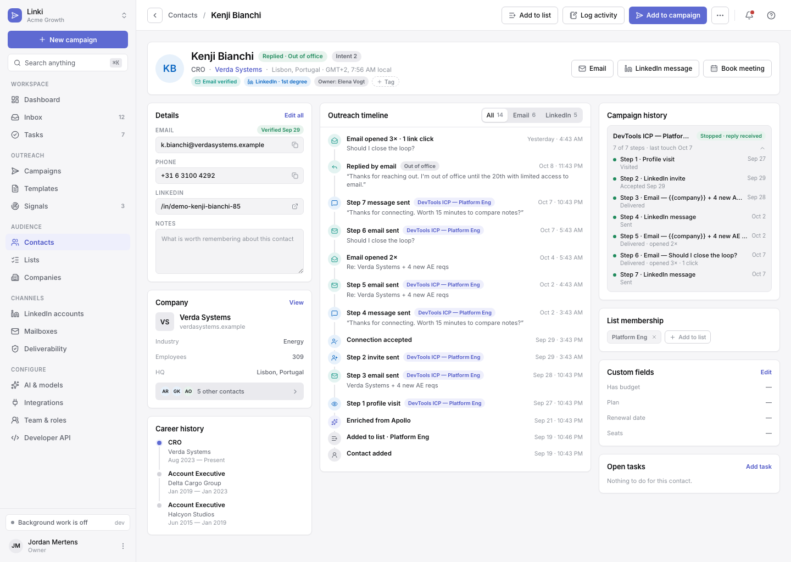</td>
  </tr>
  <tr>
    <td align="center">Contacts</td>
    <td align="center">A contact</td>
  </tr>
  <tr>
    <td width="50%">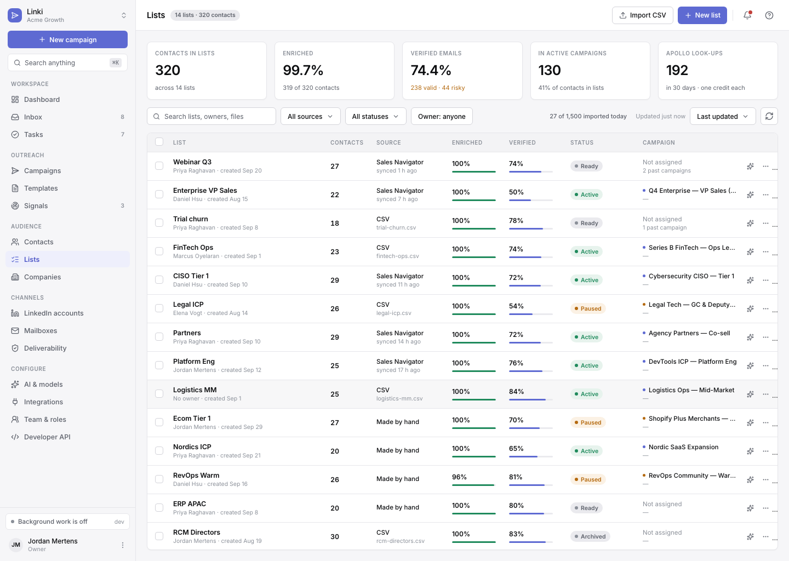</td>
    <td width="50%">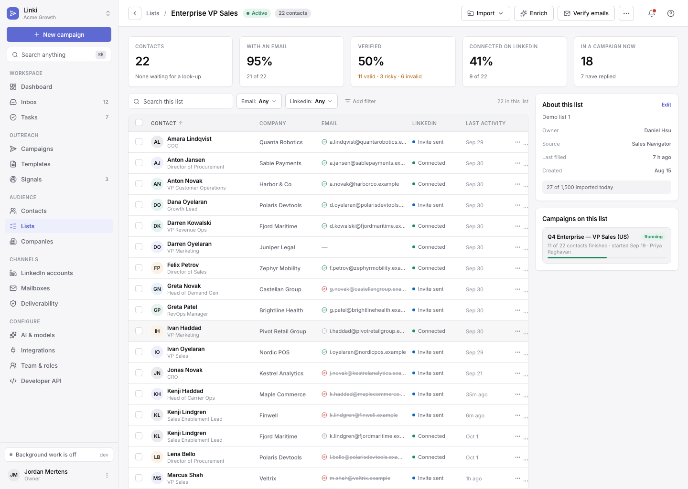</td>
  </tr>
  <tr>
    <td align="center">Lists</td>
    <td align="center">A list</td>
  </tr>
</table>

<p align="center">
  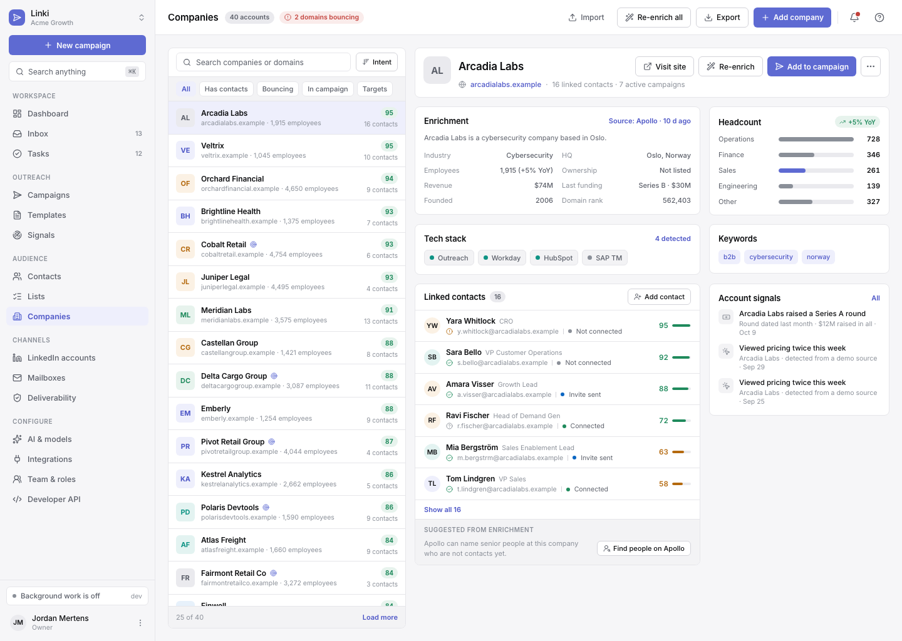
</p>

### Templates and signals

- **Templates** are a library of messages by channel and category. A step can draw on one or rotate through several, and each template shows how often it was used and how many of those sends were answered.
- **Signals** are reasons to reach out: a job change, a funding round, hiring, a change of tools, or one you record yourself. A signal raises the intent of the contact or company it is about.
- **Rules** decide what a signal does: add the contact to a list, or enrol them in a campaign.
- **Detection** asks Apollo about the accounts you choose to watch, on a schedule. It is off until you switch it on, shows what a run would spend before it runs, and stops at a monthly limit you set.

<table>
  <tr>
    <td width="50%">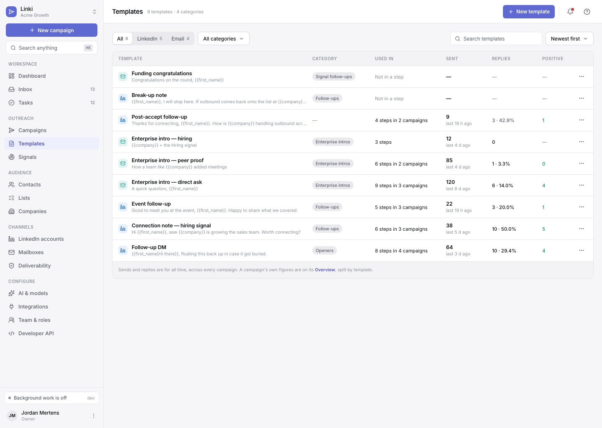</td>
    <td width="50%">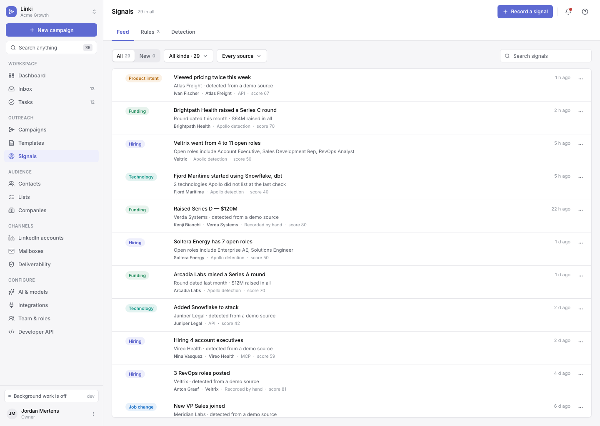</td>
  </tr>
  <tr>
    <td align="center">Templates</td>
    <td align="center">Signals</td>
  </tr>
</table>

### Pipeline, tasks and meetings

- **A board** of opportunities by stage, with stages you define, amounts, owners and expected close dates, and figures for the open pipeline, win rate and deal size.
- **Tasks** with a due time, a priority and a person to do them, about a contact, a company or an opportunity. Linki makes one itself when someone replies positively, or when a step in a sequence says to.
- **An opportunity from a reply.** A positive reply can open an opportunity by itself. New workspaces start with that on; you can switch it off where you edit the stages.
- **Meetings** are read from a calendar: an iCal feed, or Google or Microsoft by signing in when the instance has been given the provider's app (see `.env.example`).
- **Activity** lists what happened in the pipeline and who did it.

<p align="center">
  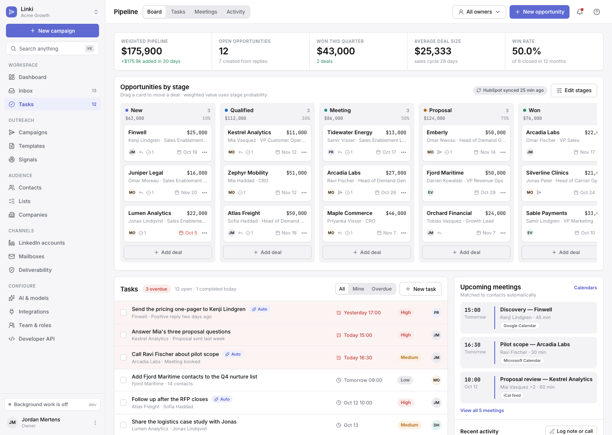
</p>

### Reporting

- **The dashboard** shows emails sent, LinkedIn actions, reply rate, positive replies and meetings booked against the period before, daily activity, a funnel, today's sends against the limits, and what needs attention.
- **A campaign's overview** shows acceptance, reply, open, click and completion rates, daily activity, and a funnel from enrolled to meeting booked.
- **A/B results you can trust.** A version is called the likely winner only when it has at least 30 sends and its lead over every other version is unlikely to be chance. Replies decide; opens count only as a weaker signal. Promoting a winner pauses the other versions and keeps their results. Automatic promotion exists and is off unless you switch it on.
- **Opens by machines** (security scanners, mail privacy features) are counted apart, so the open rate is people.
- **Share a report** with someone who has no account: a read-only link to a campaign's figures that you can switch off.
- **CSV export** of contacts, list members, replies, a campaign's prospects and figures, campaigns and the do-not-contact list. Manager role and above; each export is written to the audit log.

<table>
  <tr>
    <td width="50%">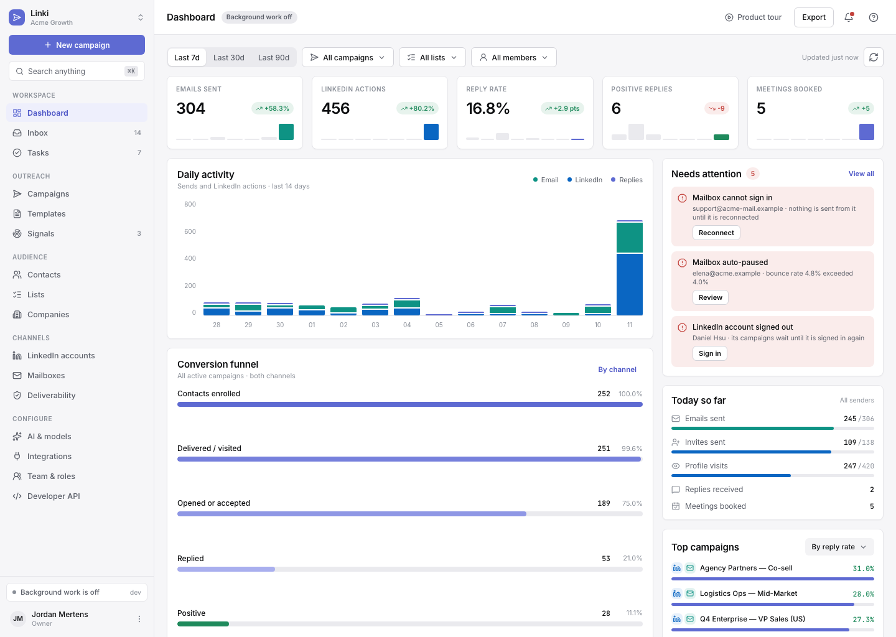</td>
    <td width="50%">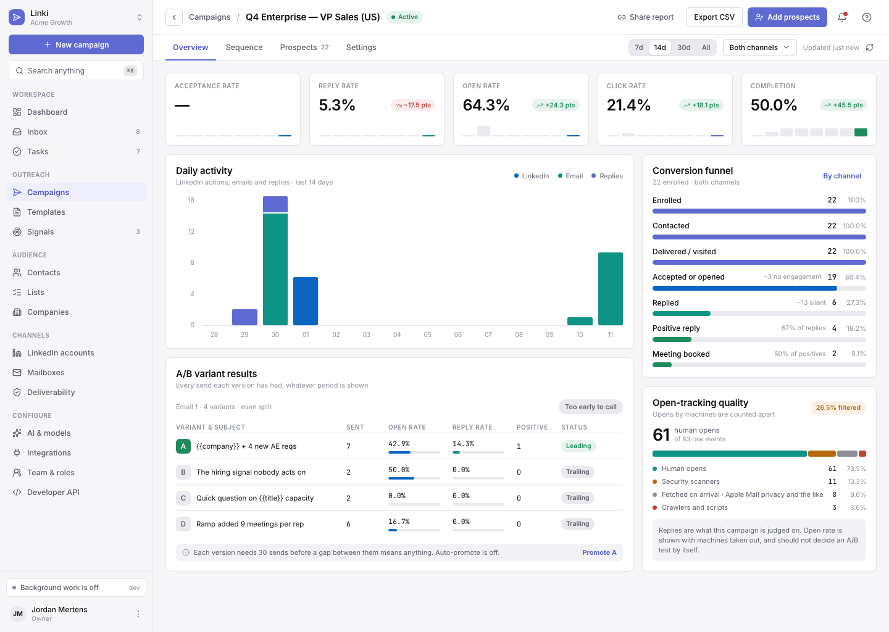</td>
  </tr>
  <tr>
    <td align="center">Dashboard</td>
    <td align="center">A campaign's overview</td>
  </tr>
</table>

### Team, API and integrations

- **Five roles:** owner, admin, manager, member and viewer, enforced in the app, the API and the MCP server alike. A member can be suspended.
- **Invitations** by email, with a link that works once and expires after seven days.
- **An audit log** of every change, with who made it, from which address, and whether it came from the web, the API or MCP. Kept for 12 months.
- **Workspaces** are separate: each has its own contacts, mailboxes, accounts and keys, and one person can belong to several.
- **Public API, webhooks and an MCP server**, described [below](#public-api).
- **Integrations:** Apollo, OpenRouter, two-way contact sync with HubSpot and Salesforce, and calendars.

<table>
  <tr>
    <td width="50%">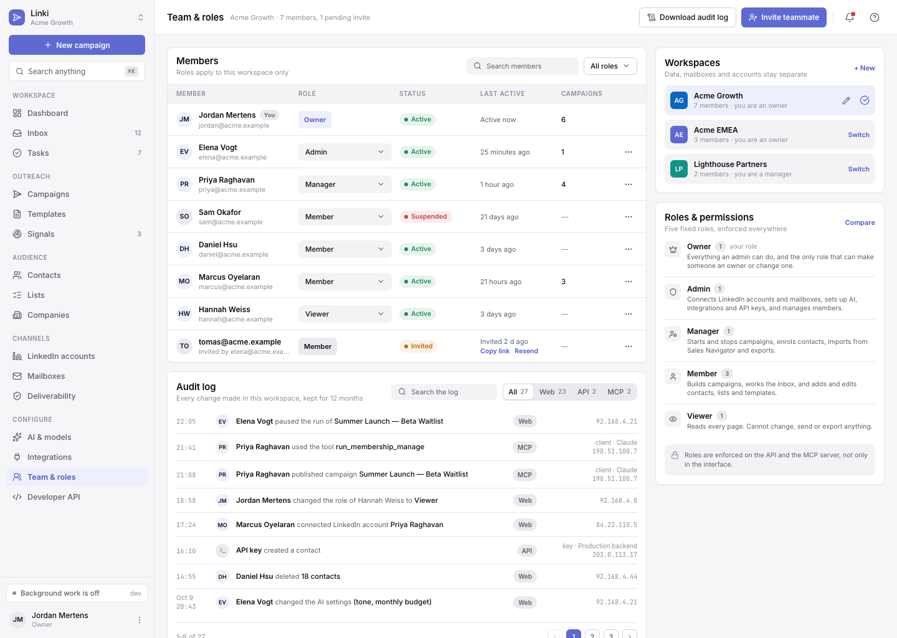</td>
    <td width="50%">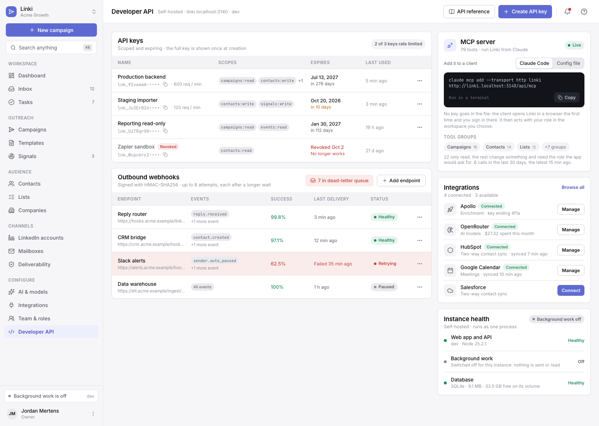</td>
  </tr>
  <tr>
    <td align="center">Team &amp; roles</td>
    <td align="center">Developer API</td>
  </tr>
</table>

---

## Run it locally

Requires Node.js 22 or newer.

```bash
npm install
cp .env.example .env.local
```

Put two values in `.env.local`:

```env
# Signs sessions and encrypts stored secrets. Generate with: openssl rand -base64 32
NEXTAUTH_SECRET=your_random_secret_here

# The address you open the app at
NEXTAUTH_URL=http://localhost:3000
```

Then start it:

```bash
npm run dev
```

Open `http://localhost:3000`, choose **Create account** on the sign-in page, and enter an email and a password. The database is created at `./linki.db` on first start and brought up to date on every start; there is no migration step.

For a production build, `npm run build` and then `npm start`.

### Environment variables

`.env.example` lists every setting with a longer note on each. The ones you are most likely to need:

| Variable | What it does |
| --- | --- |
| `NEXTAUTH_SECRET` | Required in production. Signs sessions and is the key that stored mailbox passwords, LinkedIn sessions and service keys are encrypted with. Keep it: a backup cannot be read without it. |
| `NEXTAUTH_URL` | The public address of the app. |
| `INTERNAL_API_SECRET` | Lets the MCP server call the app's own API. Set it if you use MCP. |
| `SYSTEM_SMTP_HOST`, `SYSTEM_SMTP_PORT`, `SYSTEM_SMTP_USER`, `SYSTEM_SMTP_PASSWORD`, `SYSTEM_SMTP_FROM` | The mailbox the instance itself sends from: password resets and "confirm your email" for new accounts. Without it neither happens. |
| `SUPERADMIN_EMAILS` | Who may open `/admin`, the instance's own overview. Empty means nobody. |
| `LINKI_DB_PATH` | Where the SQLite file is. Defaults to `./linki.db`. |
| `LINKI_RUNNER` | `off` starts the app with no background work: nothing is sent or read. For demo data and rehearsals. |
| `GOOGLE_CALENDAR_CLIENT_ID`, `GOOGLE_CALENDAR_CLIENT_SECRET`, `MICROSOFT_CALENDAR_CLIENT_ID`, `MICROSOFT_CALENDAR_CLIENT_SECRET` | Optional. Let a member connect a Google or Microsoft calendar by signing in. Without them, a calendar is connected by its iCal feed address. |
| `LINKI_WELCOME_PAGE` | `on` makes the public page at `/welcome` the front door. See [The public page](#the-public-page). |
| `EMAIL_TRACKING_BASE_URL` | The public HTTPS address used in open, click and unsubscribe links. Defaults to `NEXTAUTH_URL`. |
| `MCP_ALLOWED_ORIGINS` | Extra browser origins allowed to call the MCP endpoint. |
| `OPENROUTER_BASE_URL` | Send AI requests to a gateway of your own instead of OpenRouter. |
| `HEADLESS` | `false` shows the browser window during LinkedIn automation, for debugging. |

### Demo data

A workspace with enough in it for every screen to have something to show: 320 contacts, 15 campaigns, mailboxes, LinkedIn accounts, conversations and a team. Every address is on a reserved domain and nothing in it can sign in anywhere.

```bash
mkdir -p .demo
```

```bash
LINKI_DB_PATH=.demo/linki-demo.db npm run seed:demo -- --fresh
```

```bash
LINKI_DB_PATH=.demo/linki-demo.db LINKI_RUNNER=off npm run dev
```

The seed prints the demo account to sign in with; its password is `DEMO_PASSWORD` at the top of `scripts/seed-demo.ts`. Start the app with `LINKI_RUNNER=off` so that nothing tries to act on made-up accounts. `--fresh` deletes the database file first, and only when its name contains "demo". If you seed again while the app is running, restart the app: it keeps the old file open.

### Retaking the screenshots

With the demo app running:

```bash
node scripts/screenshots.mjs
```

It signs in to the demo workspace and retakes every picture: whole screens into `docs/images` for this page, and close-ups into `public/welcome` for the public page. Give it the address if the app is not on `http://localhost:3000`, and `--only` to retake some of them:

```bash
node scripts/screenshots.mjs http://localhost:3100 --only inbox,dashboard
```

It refuses to run against anything but the demo workspace. A screen added later gets one line in the list at the top of the script.

### Tests and checks

```bash
npm test
```

```bash
npx tsc --noEmit
```

```bash
npm run lint
```

```bash
npm run build
```

`npm test` runs the whole suite against a throwaway database; it makes no call to LinkedIn, a mail server or any other service, and launches no browser. `npm run test:browser` is opt-in and drives a real Chromium against a stand-in for LinkedIn. `npm run check:routes` reports which API routes the new screens call.

---

## The public page

Every instance has a page at `/welcome` that says what Linki is, for a visitor who is not signed in. It needs no account to read and shows nothing from any workspace.

By default the home page still sends a signed-out visitor straight to sign in. To send them to `/welcome` first, set:

```env
LINKI_WELCOME_PAGE=on
```

Anyone signed in goes to their dashboard as before. The words are in `components/welcome/content.ts`.

---

## Deploying

Linki runs as one container that serves the web app, the API, the MCP server, the background work and the Chromium that LinkedIn automation uses. [DEPLOYMENT.md](DEPLOYMENT.md) is the full guide (server size, reverse proxy, health checks, backups, updates) and [OPERATIONS_RUNBOOK.md](OPERATIONS_RUNBOOK.md) covers running it day to day.

### With Docker

**1. Create your environment file**

```bash
cp .env.example .env.local
```

Fill in `.env.local`:

```env
# Public URL of the app (e.g. https://linki.yourdomain.com or http://localhost:3456)
NEXTAUTH_URL=http://localhost:3456

# Random secret: generate with: openssl rand -base64 32
NEXTAUTH_SECRET=your_random_secret_here
```

**2. Build and start the container**

`docker-compose.yml` names the upstream project's published image. To run the code in this repository, comment out its `image:` line and uncomment `build: .`, then:

```bash
docker compose up -d --build
```

Linki is now running at `http://localhost:3456`. The SQLite database is persisted in `./data/linki.db` on your host machine.
Open the sign-in page, choose **Create account**, and create an account with your email and password.

> **Security:** Registration is open by default, but every signup receives an isolated workspace. Invite teammates from **Team & roles** and grant the minimum role they need. Put production deployments behind HTTPS and use a strong `NEXTAUTH_SECRET`. Set the `SYSTEM_SMTP_*` variables so the instance can send password-reset links and ask new signups to confirm their email; without them neither happens.

The Dockerfile pins Chromium and its base image on purpose: the browser fingerprint LinkedIn sees must not change between rebuilds, or sessions are signed out. Do not unpin them.

### Without Docker

Requires Node.js 22+.

```bash
npm install
npm run build
npm start
```

---

## First steps in the app

1. **Connect a LinkedIn account.** Go to **LinkedIn accounts → Connect account** and use **Server login**: Linki signs in on the server and walks you through LinkedIn's verification (an email or SMS code, or a tap in the LinkedIn mobile app). Start with conservative limits; **Limit presets** sets what every new account starts with, including a warm-up.
2. **Connect mailboxes** (optional). Go to **Mailboxes → Connect mailbox**: a Gmail or Google Workspace address with an app password, or any other over SMTP and IMAP.
3. **Connect Apollo and an AI model** (optional). Go to **Integrations** for your Apollo key, and **AI & models** for an OpenRouter key and the models to write with.
4. **Bring in contacts.** Go to **Lists → New list**, then fill the list from Sales Navigator, a CSV file or the Contacts screen.
5. **Build a campaign.** Choose **New campaign**, pick the list and the senders, write the steps, and launch.

---

## Public API

Create a scoped key in **Developer API**, then send it as a bearer token:

```bash
curl -H "Authorization: Bearer lnk_…" \
  http://localhost:3000/api/v1/contacts
```

A key has scopes, an optional expiry date and an optional rate limit of its own; only a hash of it is stored. The app has a reference page for every endpoint at **Developer API → API reference**.

Resources include `contacts`, `companies`, `lists`, `list_members` (list↔contact membership pairs, `?list_id=`), `workflows`, `runs`, `run_profiles` (who's enrolled in a run, `?run_id=`), `run_profile_tracks` (per-target, per-channel send/reply progress within a run, `?run_id=`), `pipeline_stages`, `opportunities`, `signal_rules` (read-only — which score threshold enrolls into which workflow, and whether `auto_start` is on), `suppressions` (the do-not-contact list), `sent_messages`, `events`, `signals`, and `email_accounts` (read-only, needs `email:read` — id, from address/name, provider, verification status; secrets like the SMTP password and host are never returned). Pagination uses `limit` and `offset`. Delivery providers can report `email.delivered` or `email.bounced` through `POST /api/v1/events` with an `events:write` key.

Two actions send outbound email through Linki's own verification and delivery pipeline instead of a caller reimplementing either:

- `POST /api/v1/contacts/verify` — body `{ "contact_ids": [...] }`. Verifies each contact's email (API check + DNS/SMTP fallback), persists `email_status`, and suppresses definitive invalids/catch-alls. Requires `contacts:write`. Returns a `{ total, valid, checked, invalid, catch_all, unknown, suppressed }` summary.
- `POST /api/v1/contacts/{id}/send` — body `{ "subject": "...", "body": "...", "email_account_id"?: "..." }`. Sends one email to that contact through the durable delivery queue, after a suppression check. Omit `email_account_id` to auto-pick the workspace's oldest verified sender. Requires the `email:send` scope — kept distinct from `contacts:write`/`campaigns:write` so a key can be granted contact management without send capability, or vice versa. Returns `409 recipient_suppressed` if the address is on the do-not-contact list.

### Webhooks

Add an endpoint in **Developer API** and choose the events it receives. Webhook signatures use `HMAC-SHA256(secret, "<x-linki-timestamp>.<raw-body>")` and arrive in `x-linki-signature` as `sha256=<hex>`. A delivery that fails is tried up to eight times, each after a longer wait, and then set aside in a dead-letter queue, from where you can send it again. Endpoints on private, loopback and link-local addresses are refused unless `WEBHOOK_ALLOW_PRIVATE_NETWORKS=true`.

### MCP

Connect an MCP client to `https://your-linki-host/api/mcp`. Authorization discovery, OAuth client registration, PKCE authorization, refresh tokens, and resource binding are exposed automatically. MCP access tokens carry the authorizing user's workspace and role, so tool calls preserve the same tenant and permission boundary as the web app.

With Claude Code:

```bash
claude mcp add --transport http linki https://your-linki-host/api/mcp
```

Claude's official web origins are accepted automatically. For another browser-based MCP client, add its HTTPS origin to the comma-separated `MCP_ALLOWED_ORIGINS` environment variable.

Every authenticated workspace operation is MCP-usable. Dedicated tools cover contacts, companies, custom fields, lists/imports, templates, conditional workflows and steps, campaign runs/enrollments, LinkedIn and email senders, reply intelligence, the collaborative inbox, suppression, deliverability, signals, pipeline/meetings, CRM/calendar sync, integration credentials, AI configuration, events/webhooks, API keys, workspace invitations/members, audit logs, and application settings. `linki_api_request` provides a permission-aware compatibility path for future authenticated endpoints, while `linki://workspace/capabilities` reports the live coverage map.

Security/bootstrap operations—password login/signup, OAuth token issuance, MCP transport, host updates, and public invitation acceptance—remain outside authenticated MCP tools by design. OAuth authorization binds the resulting token to the workspace currently selected in Linki.

### Team invitations

Open **Team & roles**, choose **Invite teammate**, enter their email, and select a role. Linki creates a single-use link that expires after seven days and sends it through the workspace's configured SMTP account; if no sender is available, copy the returned link. Existing users sign in before accepting, new users create their account from the invitation, and members of multiple workspaces can switch from the same screen. Owners and administrators can list or revoke pending invitations from the UI, REST endpoint, or `workspace_invitation_manage` MCP tool.

---

## Where this comes from

This repository is a fork of [moaljumaa/linki](https://github.com/moaljumaa/linki), and its interface and much of what is described above have moved on from upstream's. The upstream project has a [Discord community](https://discord.gg/8VPeFDJMn), and is offered as one-click managed hosting on [Opsily](https://opsily.com/hosting/linki), which runs upstream's release rather than the code in this repository.

---

## License

Linki is source-available under the [Linki Sustainable Use License](LICENSE).

**You can:** use it personally, use it for your business, self-host it on your own VPS or laptop, modify it, contribute to it.
